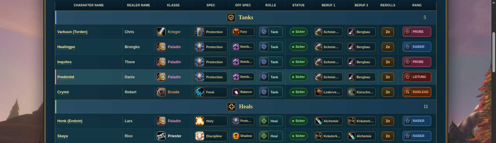

# Vision: Roster, Armory und Guides – 11. November 2026

## Status

Am 11.11.2026 auf `vision-eu.de` eingespielt und anschließend live geprüft. Nach der gezielten Schreibfreigabe wurde die Website-Datei mit Sicherung und Prüfung des unveränderten Ausgangsstands aktualisiert. Der separat beauftragte Reset für das Admin-Konto Vision ist ausgeführt; die Anmeldung wurde erfolgreich geprüft, bestehende Sitzungen wurden über die Anwendung ungültig gemacht und die Prüfsitzung wurde abgemeldet. Dieses Repository enthält keine Kennwörter oder Kennworthashes.

## Roster

- Die sichtbaren Spalten ST und A/G entfallen in Anzeige, Pause/Reserve, Inline-Bearbeitung und Formularen.
- Die Namensspalte erhält mehr Breite. Lange Namen können umbrechen; Namen mit Leerzeichen sind möglich.
- Die Neuanlage zeigt den Platzhalter „z. B. Zuku Vision“. Bestehende Charakternamen werden nicht umbenannt.
- Vorhandene ST-/AG-Werte werden beim Bearbeiten weiter erhalten; die gespeicherten Mitgliederdaten werden durch dieses Frontend-Update nicht migriert oder gelöscht.

## Armory-Verlinkung

- Charakternamen öffnen die Blizzard-Forever-Armory in einem neuen Tab, sowohl am Desktop als auch mobil und in Pause/Reserve. Die bisherigen Roster-Details bleiben über eine eigene ⓘ-Schaltfläche erreichbar.
- Oberhalb des Rosters steht der Link „Gilden-Armory“. Auch die Detailansicht enthält einen Armory-Link.
- Vollständige Namen erzeugen ihren Link dynamisch: Unicode-NFC, Kleinschreibung, Leerzeichen zu Bindestrichen, URI-Kodierung. Umlaute und Sonderbuchstaben bleiben erhalten. Abschließende Klammernotizen gehören nur zur Roster-Anzeige.
- 37 ältere Einwortnamen sind anhand eindeutiger, exakt geschriebener Vornamen im Blizzard-Gildenverzeichnis zugeordnet. Diese Zuordnung ist eine Momentaufnahme vom 11.11.2026; ein vollständig eingetragener Name hat immer Vorrang.
- Im geprüften Bestand ergeben sich 48 direkte Charakterlinks und 66 Links zur Gildenübersicht. Alle 48 direkten Ziele sind im beobachteten Blizzard-Verzeichnis mit 83 Mitgliedern enthalten. Mehrdeutige Einträge wie „Layelle“ und nicht zuordenbare Einwortnamen führen zur Gildenübersicht, bis der vollständige Name eingetragen wird.
- Bestehende Namen werden nicht automatisch umbenannt; gespeichert wurden ausschließlich Änderungen an der Frontend-Datei. Der Roster-Hash vor und nach der Veröffentlichung ist unverändert.

## Guides Forever

- Alle 28 vorhandenen Spezialisierungsguides mit wowtbc.gg abgeglichen; kurze deutsche Zusammenfassungen je Spezialisierung in den vorhandenen aufklappbaren Karten.
- Veraltete Level-30-Beta-Verweise durch Hinweise auf aktuelle Leveling-Builds 1–60 ersetzt.
- Dungeon-Level nach der aktuellen Loot-Übersicht: Ruins of Lordaeron 16–23, Excavation Site: Wetlands 26–32, City of Dalaran 28–34.
- Troll–Hexenmeister ergänzt; verbliebene Abweichungen zwischen Skyborne-/Magier-Quellen benannt.
- Abgleichdatum 11.11.2026. Das von der Newsübersicht ausgewiesene eigene Aktualisierungsdatum bleibt 15.09.2026.
- SOURCES.json enthält die verwendeten URLs. Es wurden eigene Kurzfassungen erstellt, keine vollständigen Fremd-Guides kopiert.

## Dateien und Integration

`index.html` ist die vollständige geänderte Frontend-Datei. `update.patch` zeigt ausschließlich die Änderungen gegenüber der gelesenen Live-Datei. Vor dem Einspielen den aktuellen Serverstand erneut vergleichen und sichern.

Zieldatei: `/srv/ashen-realms/assets/vision-eu-site/index.html`

SHA-256 des geprüften Ausgangsstands: `2016688b2fc80fe597825e5008b1cf2be1d50d5269b433df83b6d1ba5d82dc44`

Die bestehenden `/api/*`-Endpunkte, Backenddateien, lokalen Bilddateien und Roster-Daten bleiben auf dem Server. Dieser Branch ist kein vollständiges neues Vercel-Projekt. Automatische Vercel-Deployments sind nur für diesen Arbeitsbranch deaktiviert.

Die zuvor fehlenden Schreibfreigaben wurden vom Eigentümer gezielt für die Website-Zieldatei und die Benutzerdatei erteilt und vor dem Einspielen geprüft. Sicherungen beider Dateien wurden erstellt; Dateieigentümer und Zugriffsrechte sind erhalten geblieben.

SHA-256 der veröffentlichten Frontend-Datei: `0c7fd2ef8fe35760b4da9f269dfdae63bc6e9b0e85de1a546a721c82be324ba3`. Der per HTTPS ausgelieferte Inhalt stimmt bytegenau damit überein.

## Validierung

### Ergänzende Armory-Prüfung

- Alle 83 beobachteten vollständigen Blizzard-Namen ergeben exakt die vom Gildenverzeichnis gelieferten URLs. Alle 37 übernommenen Vornamen sind innerhalb dieses Verzeichnisses eindeutig.
- Isolierte Browservorschau bei 1440/1638 px und 390 px: richtige Links, erhaltene Namensumbrüche, keine horizontale Seitenüberbreite und keine verschachtelten Links/Schaltflächen.
- Desktop- und mobile ⓘ-Schaltfläche öffnen die bestehende Detailansicht. Die Links für Zuku und die Gildenübersicht öffnen echte neue Tabs mit den erwarteten Blizzard-Seitentiteln.
- 114 Einträge nach Öffnen von Pause/Reserve; 48 direkte Links und 66 Gildenlinks in beiden Darstellungen. Keine beobachteten JavaScript-Fehler während dieser Prüfung.
- Frische öffentliche Live-Browserprüfung bei 1440 und 390 px bestätigt die 114 Einträge, 48 direkten Links und 66 Gildenlinks. Zuku, Styæ und Varkuun korrekt verlinkt; Details und Admin-Anmeldefenster öffnen. Keine Seitenüberbreite, keine beobachteten JavaScript-Fehler und keine schreibenden HTTP-Anfragen.
- Atomare Veröffentlichung mit Prüfung des Ausgangsinhalts und automatischem Backup. Live-HTTP-Antwort 200; ausgelieferte Datei stimmt mit dem angegebenen SHA-256 überein. Keine Änderung an Roster- oder Benutzerdateien für diese Ergänzung.

### Roster und Guides

- Vollständiges Inline-JavaScript syntaktisch geprüft.
- Browserprüfung der kombinierten Frontend-Datei bei 1638 px und 390 px; keine horizontale Seitenüberbreite.
- Anzeige und Pause/Reserve: 11 Spalten; Bearbeitung und Neuanlage: 12 sichtbare Spalten inklusive Bereich/Aktion.
- Namensfeld in der Desktopvorschau 222,6 px breit; „Zuku Vision“ im Bearbeitungsformular geprüft.
- 61 aktive und 50 pausierte Mitglieder in der Vorschau geladen.
- Guides: 9 Klassenkarten, 28 Spezialisierungslinks, korrigierte Dungeon-Werte. Klassenfilter und Suche nach „Heating Up“ funktionieren.
- Die Vorschau lief ausschließlich in einem isolierten Browser; schreibende HTTP-Anfragen waren gesperrt. Es gab keine Änderungen an Live-Mitgliederdaten.
- Nach dem Einspielen live bestätigt: 64 aktive und 50 pausierte Mitglieder, insgesamt 114. Website und Roster-API antworten mit HTTP 200.
- Zusätzliche Live-Browserprüfung bei 1440, 1024 und 390 px: korrekte Spalten, Namensumbruch, keine horizontale Seitenüberbreite und keine beobachteten JavaScript-Fehler.
- Roster-Daten, Backenddatei und die übrigen fünf Benutzerkonten sind anhand von Hashvergleichen unverändert. Die Benutzerdatei behält Modus 0600.
- Admin-Anmeldung mit dem beauftragten Kennwort erfolgreich; Sitzungswiderruf und anschließende erneute Anmeldung sowie Abmeldung geprüft.

